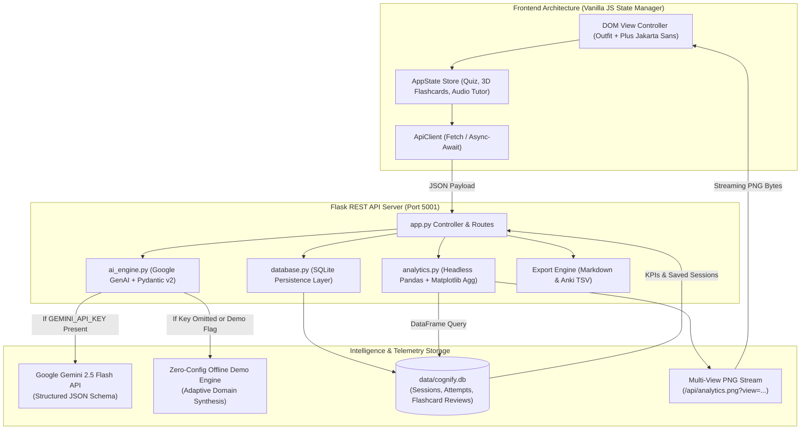

# Cognify — AI-Powered Academic & Exam Architect

> A focused study tool that transforms unstructured lecture transcripts and textbook excerpts into structured concept breakdowns, interactive 3D flashcards, active-recall quizzes, diagnostic telemetry, and visual analytics.

[](https://python.org)
[](https://flask.palletsprojects.com/)
[](https://ai.google.dev/)
[](https://docs.pydantic.dev/)
[](https://pandas.pydata.org/)
[](https://matplotlib.org/)

---

## Why Cognify?

Passive studying is deceptive. Highlighting notes and rereading textbook paragraphs creates the illusion of competence: the material looks familiar on the page, but when you are tested on an applied problem, recall collapses.

Cognitive science has repeatedly shown that durable learning requires three things:
1. **Active retrieval**: forcing your brain to pull information out, rather than passively recognizing it.
2. **Spaced repetition**: reviewing concepts right when forgetting begins to set in.
3. **Targeted diagnostics**: knowing exactly which subtopics you struggle with before exam day.

Cognify automates this entire workflow: paste in messy lecture transcripts or textbook chapters, and it deconstructs them into typed mental models, creates Leitner spaced-repetition flashcards, generates multiple-choice recall quizzes with detailed explanations, and visualizes your retention curve over time.

---

## System Architecture



---

## Key Feature Suite

1. **Structured Academic Extraction via Google Gemini 2.5 Flash**:
   - Integrates the official `google-genai` SDK using `gemini-2.5-flash`.
   - Strictly validates outputs against a strongly typed `StudyPackSchema` using **Pydantic v2**.
   - Extracts executive summaries, key terms with academic definitions and exam warnings, 3D active-recall flashcards, formula/rule cheatsheets, common exam traps, a 5-question active recall test, and an algorithmic 3-step study roadmap.

2. **Zero-Config Offline Demo Mode**:
   - Cognify is 100% operational immediately upon cloning without requiring an active API key or cloud credentials.
   - Detects when `GEMINI_API_KEY` is not configured and dynamically routes queries through an adaptive domain synthesis engine with hyper-realistic technical topic banks (Calculus, Molecular Biology, Distributed Systems, Geopolitics).

3. **3D Interactive Flip Flashcards & Spaced-Repetition Engine**:
   - Real-time 3D CSS perspective card flips on click or via keyboard shortcut (`Spacebar`).
   - Leitner Spaced-Repetition rating buttons: **Again (1m)**, **Hard (6m)**, **Good (1d)**, **Easy (4d)**.
   - Every rating is persisted to the `flashcard_reviews` SQLite table for retention analytics.

4. **Interactive Active-Recall Quiz Engine**:
   - 5-question multiple choice quizzes with instant grading, option badges (A, B, C, D), and expandable pedagogical explanations.
   - Live elapsed-time stopwatch and full keyboard accessibility (`1-4` for option selection, `Enter` to advance).
   - Audio Tutor button utilizing the native **Web Speech API** to read questions and explanations aloud.
   - Generates a post-quiz diagnostic scorecard classifying performance (Mastery $\ge 80\%$, Proficient $65-79\%$, At-Risk $<65\%$).
   - Automatically logs weak subtopic tags to SQLite upon quiz completion.

5. **Headless Multi-View Pandas & Matplotlib Telemetry Engine**:
   - Configured with `matplotlib.use("Agg")` for thread-safe macOS and headless Linux execution.
   - **View 1: Mastery & Retention** (`?view=mastery`):
     - Left: **Subject Mastery Index (%)** horizontal bar chart color-coded dynamically (Emerald $\ge 80\%$, Sky Blue $65-79\%$, Rose $<65\%$).
     - Right: **Rolling Retention & Score Progression Curve** with shaded confidence envelope and an 80% mastery benchmark.
   - **View 2: Diagnostics & Pace** (`?view=diagnostics`):
     - Left: **Weak-Spot Diagnostic Frequency** error counts across all past attempts.
     - Right: **Study Pace vs Mastery Correlation** scatter quadrant with polynomial efficiency fit.

6. **Full Academic Export Engine**:
   - **Markdown (.md)**: One-click formatted download with executive summaries, concept tables, formulas, and flashcards.
   - **Anki Flashcard Deck (.txt)**: Tab-separated, HTML-ready file formatted directly for import into Anki desktop or mobile.
   - **Clipboard & PDF Print**: Copy full study guide to clipboard or trigger print-optimized CSS for PDF archiving.

7. **Clean Dark Architecture & Tactile Motion**:
   - High-craft dark aesthetic featuring Outfit display typography, Plus Jakarta Sans body, dynamic cursor spotlight lighting on cards, kinetic marquee streamer, 3D floating isometric layer stack with cursor tilt, live search in saved sessions, and mobile responsiveness.

---

## Project Structure

```text
cognify/
├── .gitignore               # Ignores venv, SQLite data/*.db, caches, and secrets
├── .env.example             # Template for GEMINI_API_KEY and server flags
├── requirements.txt         # Core dependencies (Flask, google-genai, pydantic, pandas, matplotlib)
├── app.py                   # Flask REST server, routes, and export engine on port 5001
├── ai_engine.py             # Gemini 2.5 Flash wrapper with strict Pydantic schema + Demo fallback
├── database.py              # SQLite persistence (study_sessions, quiz_attempts, flashcard_reviews)
├── analytics.py             # Headless Pandas + Matplotlib multi-view telemetry chart generator
├── templates/
│   └── index.html           # Semantic, modular HTML5 workspace with mobile navigation
├── static/
│   ├── css/
│   │   └── style.css        # Dark-mode styling, 3D flashcards, spotlight glow, print CSS
│   └── js/
│       └── app.js           # Decoupled vanilla JS state manager, audio tutor, quiz engine
└── README.md                # Technical documentation & API contract
```

---

## Quickstart & Installation

### 1. Clone & Enter Directory
```bash
git clone https://github.com/lalitg13/cognify.git
cd cognify
```

### 2. Configure Virtual Environment & Install Dependencies
```bash
python3 -m venv venv
source venv/bin/activate
pip install -r requirements.txt
```

### 3. (Optional) Set Environment Variables
Cognify runs in Zero-Config Demo Mode out of the box without any key required. If you want to connect live to Google Gemini 2.5:
```bash
cp .env.example .env
# Edit .env and paste your GEMINI_API_KEY
```

### 4. Start the Application
```bash
python app.py
```
Open your browser and navigate to: **[http://localhost:5001](http://localhost:5001)**.

---

## REST API Contract

| Endpoint | Method | Description |
| :--- | :--- | :--- |
| `GET /api/dashboard` | `GET` | Fetches aggregate KPIs, AI status, and recent history. |
| `POST /api/generate` | `POST` | Submits raw notes; returns structured `StudyPackSchema` + `session_id`. |
| `GET /api/session/<id>` | `GET` | Retrieves full JSON payload of a saved study session. |
| `DELETE /api/session/<id>` | `DELETE` | Deletes a saved study session and related quiz logs. |
| `POST /api/submit_quiz` | `POST` | Logs a completed quiz attempt, updating mastery scores and weak subtopics. |
| `POST /api/flashcard/review`| `POST` | Logs Leitner rating (`again`, `hard`, `good`, `easy`) for spaced repetition. |
| `GET /api/analytics.png` | `GET` | Streams live Matplotlib telemetry image (`?view=mastery` or `?view=diagnostics`). |
| `GET /api/export/<id>/markdown` | `GET` | Generates and downloads formatted `.md` study guide. |
| `GET /api/export/<id>/anki` | `GET` | Generates and downloads formatted `.txt` Anki import deck. |
| `POST /api/reset_demo` | `POST` | Drops and re-initializes SQLite database with pristine historical seed data. |

---

## Verification & Automated Tests

Verify all components via the command line:

```bash
# 1. Test database schema & auto-seeder
python database.py

# 2. Test headless analytics chart generation
python analytics.py

# 3. Test AI engine fallback & schema compliance
python ai_engine.py

# 4. Run end-to-end API test suite
python -c "
from app import app
client = app.test_client()
assert client.get('/api/dashboard').status_code == 200
assert client.get('/api/analytics.png?view=mastery').status_code == 200
assert client.get('/api/analytics.png?view=diagnostics').status_code == 200
assert client.get('/api/export/1/markdown').status_code == 200
assert client.get('/api/export/1/anki').status_code == 200
print('All core API integration tests passed.')
"
```

---

## License

MIT License. Built for high-leverage academic retention and engineering portfolios.
