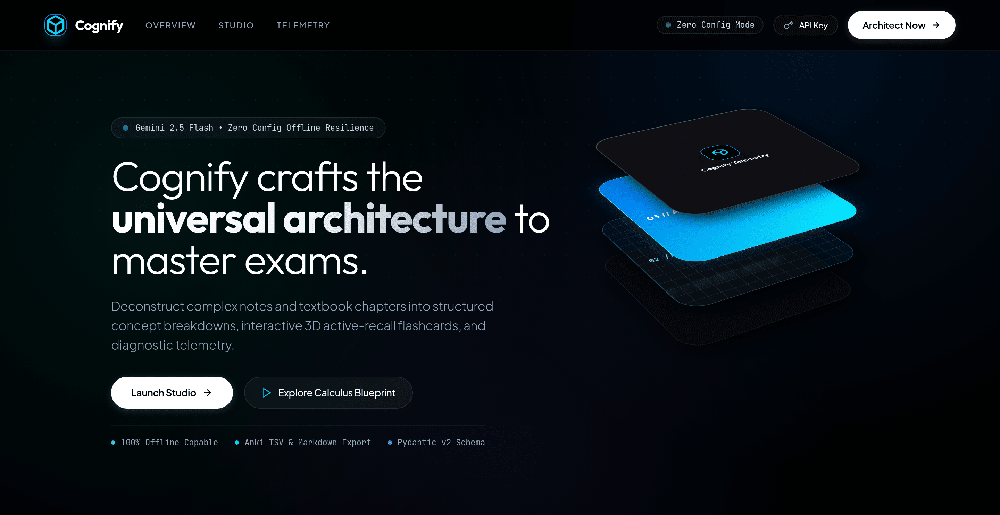
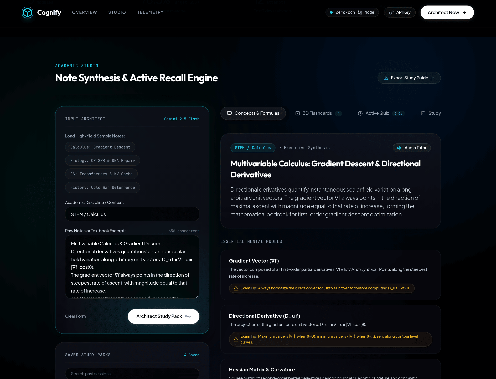
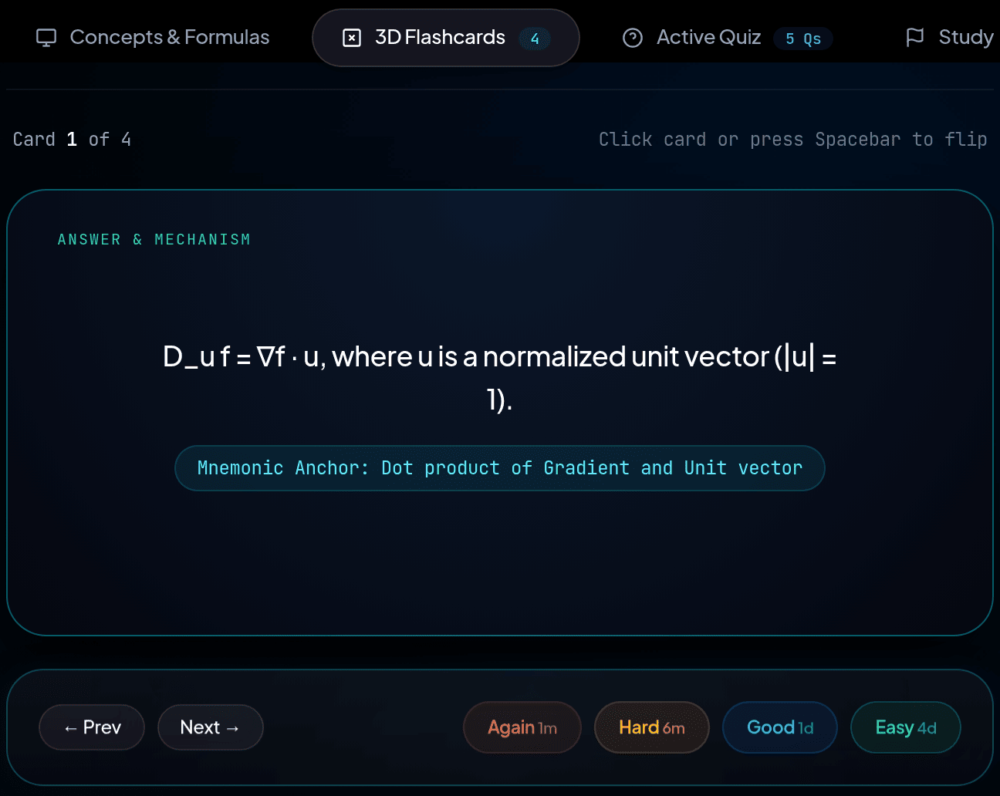
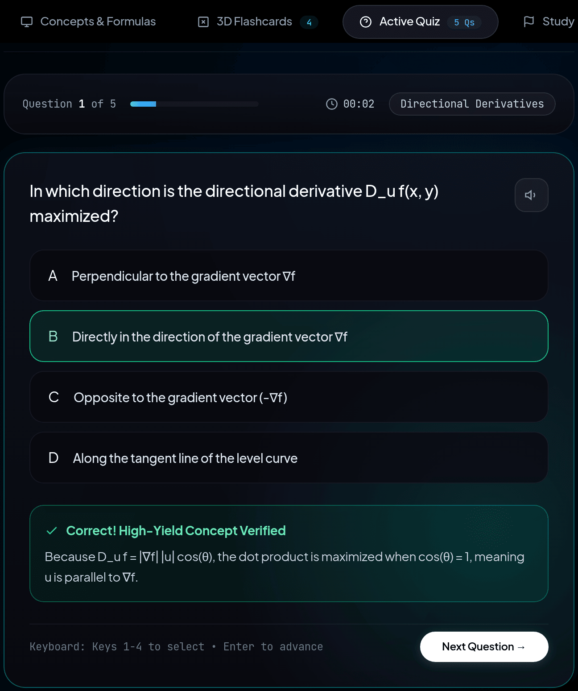
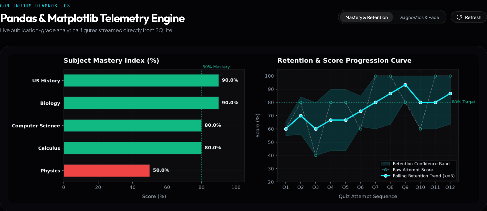
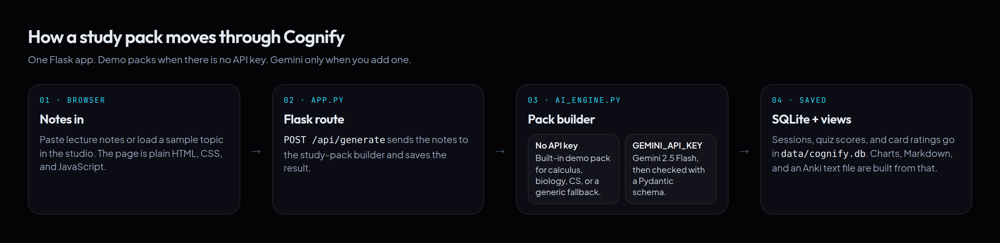

# Cognify

Cognify is a Flask study app for turning a block of lecture notes into something you can practice. You paste notes, or load one of the four samples, and the app saves a study pack: a summary, concept cards, formulas, common mistakes, flip flashcards, a five-question quiz, and a three-step study list.

The idea is active recall. Rereading a page feels familiar. A quiz and a flashcard force you to pull the idea back out. Cognify is that loop in one page: make a pack, flip cards, take the quiz, and look at charts of the scores you have saved.

It is a high-school CS portfolio project. One Python process serves the page and the API. SQLite stores packs and scores. Google Gemini is optional.

It runs with no API key. That path is demo mode. The header badge says **Zero-Config Mode**, and the pack comes from built-in examples instead of a model.



## Why it exists

Studying for an exam usually means a notes file and a hope that it sticks. Cognify is a small workspace that keeps the next step next to the notes:

1. Put messy notes in one box.
2. Get a structured pack back, either from a built-in example or from Gemini.
3. Practice with flashcards and a short quiz on that same page.
4. Keep the score, and draw charts from the scores in the database.

The page does not replace a textbook. It is a study surface for one topic at a time, with the history of those sessions saved locally.

## Study workspace



The shot above is demo mode. The calculus sample was loaded, then **Architect Study Pack** was clicked. No API key was set.

The label "Gemini 2.5 Flash" on the input card is fixed text in the page. The header badge is the mode that is actually running. **4 Saved** is the three sample packs that ship with a new database, plus the calculus pack just created.

On load, the browser calls `GET /api/dashboard`, fills the count strip, lists saved packs, and opens the newest one. The four sample buttons only fill the form. They do not call the model until you click **Architect Study Pack** (or press Ctrl/Cmd+Enter).

| Flashcards | Quiz |
| --- | --- |
|  |  |

## What a study pack contains

A pack is one JSON object checked by the Pydantic model `StudyPackSchema` in `ai_engine.py`. Gemini is asked to fill that shape. Demo mode returns a hand-written object that passes the same model.

| Field | What it is |
| --- | --- |
| `topic_title` | Title shown at the top of the pack |
| `subject_category` | Subject label, such as `STEM / Calculus` |
| `difficulty_rating` | Integer from 1 to 10, shown as `Diff: N/10` |
| `executive_summary` | Short synthesis under the title |
| `key_concepts` | Term, definition, and an exam tip |
| `formula_sheet` | Name, formula or rule, and when to use it |
| `common_misconceptions` | Myth, correction, and why it matters |
| `flashcards` | Front, back, and an optional mnemonic |
| `quiz_questions` | Five multiple-choice questions |
| `study_roadmap` | Three timed next steps |

The prompt sent to Gemini asks for 3 to 6 concepts, 4 to 8 flashcards, 2 to 4 formulas, 2 to 3 misconceptions, exactly 5 questions, and exactly 3 roadmap steps. Each question has four options, a `correct_index` of 0–3, an explanation, and a `subtopic_tag`.

The whole object is stored as `payload_json` on the `study_sessions` row. Opening a saved pack reads that JSON back. Nothing is re-generated.

### Concepts, formulas, and the study list

The **Concepts & Formulas** tab renders the summary, each concept with its exam tip, the formula sheet, and the misconception cards. **Study Protocol** lists the three roadmap steps with the minute estimate and focus area from the pack.

**Audio Tutor** uses the browser `speechSynthesis` API. It reads the title and the executive summary. If the browser has no speech API, the page shows a toast and stops. The quiz has its own speaker button, which reads the current question only.

### Flashcards and the rating buttons


The card is a CSS 3D flip (`rotateY`). Click the card, or press Space while this tab is open, to turn it over. Prev and Next move through the pack's cards. The mnemonic, when the pack has one, sits on the back.

The four buttons are labeled like a Leitner box:

| Button | Label on the page | Value saved |
| --- | --- | --- |
| Again | 1m | `again` |
| Hard | 6m | `hard` |
| Good | 1d | `good` |
| Easy | 4d | `easy` |

Those times are text in the HTML. `POST /api/flashcard/review` writes `session_id`, `card_index`, and the rating string into `flashcard_reviews`. There is no `due_at` column, and the page does not hide a card until that interval is over. After a click it logs the rating and advances to the next card.

### Quiz


Each pack carries five questions. The page shows them one at a time.

- Keys 1–4 select an option. Enter grades the current question, or moves on after it has been graded.
- The correct option is highlighted after you submit. The explanation from the pack is shown under the choices.
- A timer starts when the quiz is set up and counts seconds on the page.
- Wrong answers keep their `subtopic_tag`. At the end, the score is the number correct divided by the number of questions, times 100. Those tags are sent as `weak_subtopics`.

The result card labels the score:

- **Mastery** at 80% or above
- **Proficient** from 65% through 79%
- **At-Risk** under 65%

`POST /api/submit_quiz` stores that attempt. The chart image is then refreshed from the database.

### Charts



`analytics.py` loads quiz rows into a Pandas dataframe and draws a PNG with Matplotlib. The backend sets `matplotlib.use("Agg")` so the server does not need a display. The browser shows the PNG from `GET /api/analytics.png` and asks again with a cache-busting query when you change view or click Refresh.

**Mastery & Retention** (`?view=mastery`, the default):

- Left: mean score by `subject_category`. Bars are green at 80% or above, blue from 65% to 79%, and red under 65%. A dotted line marks 80%.
- Right: the last 15 attempts in time order. Dashed markers are the raw scores. The solid line is a rolling mean of up to 3 attempts. The shaded band is that rolling mean plus or minus the rolling standard deviation of the same window. The legend calls the band "Retention Confidence Band". It is that window's spread, not a statistical confidence interval from a larger study.

**Diagnostics & Pace** (`?view=diagnostics`):

- Left: how often each weak-subtopic tag appears, up to six tags.
- Right: each attempt as a point of time spent (seconds) versus score. A straight line is fit with `numpy.polyfit` when there are more than two points and the times are not all the same. The same 80% line is drawn.

Any `view` value other than `diagnostics` uses the mastery figure.

A new database is not empty. `database.py` inserts three study packs and twelve quiz attempts the first time it runs, so the chart has something to draw. The percentages in the screenshot are those seed rows. They are not scores from real users. The twelve scores are listed under [Honest notes](#honest-notes).

### Export

**Export Study Guide** has four actions:

- **Markdown.** `GET /api/export/<id>/markdown` builds a `.md` file from the saved pack: title, summary, concepts, formulas, misconceptions, flashcards, and the roadmap. The download name starts with `cognify_`.
- **Anki.** `GET /api/export/<id>/anki` builds a tab-separated file with `#separator:tab`, `#html:true`, and a third column of tags. Each row is front, back, and the subject with non-letters stripped. A mnemonic is appended to the back as HTML. If the pack has no flashcards, the export makes cards from the key concepts instead.
- **Copy.** The browser copies the title, summary, and concept lines to the clipboard. It does not copy formulas or flashcards.
- **Print.** The button calls `window.print()`. A print stylesheet hides the header, footer, hero, and chart section and switches the page to a light background. Saving a PDF is the browser's print dialog, not a file generated by Flask.

### Demo mode and Gemini

`generate_study_pack` in `ai_engine.py` chooses the path:

1. If the request sets `demo_mode`, or `GEMINI_API_KEY` is missing, blank, or still the placeholder `your_api_key...`, it builds a demo pack and sets `ai_mode` to `demo`.
2. Otherwise it calls `gemini-2.5-flash` through the `google-genai` client, with `temperature` 0.3 and `response_schema` set to `StudyPackSchema`. A valid response is stored with `ai_mode` `gemini`.
3. If that call throws, the same demo builder runs and `ai_mode` is `demo_fallback`. The error text is truncated into `status_note`.

Demo mode lowercases the subject hint plus the notes and picks the first keyword group that matches:

| If the text contains | Built-in pack |
| --- | --- |
| `calc`, `deriv`, `integr`, `gradient`, `math`, `hessian` | Multivariable Calculus: Gradient Descent & Directional Derivatives |
| `bio`, `cell`, `crispr`, `gene`, `dna`, `protein`, `mitochon`, `atp` | Molecular Biology: CRISPR-Cas9 Gene Editing & DNA Repair |
| `transf`, `attent`, `llm`, `neural`, `comput`, `softw`, `code`, `ai`, `raft`, `distrib` | Computer Science: Transformer Attention Mechanisms & KV-Caching |

The check is `keyword in text`, so a short token can match inside a longer word. The history sample includes the word "Containment", which contains `ai`, so that sample currently selects the computer-science pack. Text that matches none of the lists gets a shorter generic pack: the title uses the subject hint and the first line of the notes, and the concepts are templates filled with those lines.

A key can live in two places:

- `.env` as `GEMINI_API_KEY`. The server reads this for both generation and the dashboard mode.
- The **API Key** dialog. The browser stores it in `localStorage` under `cognify_api_key` and sends it on `POST /api/generate` as `api_key` and the header `X-Gemini-API-Key`. The dashboard badge still looks only at the environment variable. With a key in the browser and none in the environment, the badge stays on Zero-Config Mode while generation uses the key you pasted.

The page loads Tailwind and the Outfit, Plus Jakarta Sans, and JetBrains Mono fonts from a CDN. Opening the UI still needs network access for that styling, even when generation is in demo mode.

## Architecture



```text
Browser (templates/index.html + static/js/app.js)
    │  fetch JSON
    ▼
Flask (app.py, port 5001)
    ├── ai_engine.py     demo pack, or Gemini 2.5 Flash + Pydantic
    ├── database.py      SQLite file data/cognify.db
    └── analytics.py     Pandas + Matplotlib PNG
```

The browser is one page. `app.js` holds the current pack, quiz state, and flashcard index, and calls the API with `fetch`. There is no separate frontend build.

### Routes that matter on a click

| What you do | What runs |
| --- | --- |
| Open the page | `GET /` renders `templates/index.html`, then the script calls `GET /api/dashboard` and `GET /api/session/<newest>` |
| Architect Study Pack | `POST /api/generate` builds the pack, inserts a `study_sessions` row, returns the pack with `session_id` |
| Open a saved pack | `GET /api/session/<id>` reads `payload_json` |
| Finish a quiz | `POST /api/submit_quiz` inserts a `quiz_attempts` row and returns updated counts |
| Rate a card | `POST /api/flashcard/review` inserts a `flashcard_reviews` row |
| Look at charts | `GET /api/analytics.png` reads attempts and returns PNG bytes |

### SQLite tables

The file is `data/cognify.db`. Foreign keys are turned on. The file is gitignored.

**`study_sessions`**

| Column | Role |
| --- | --- |
| `id` | Primary key |
| `created_at` | Timestamp, default `datetime('now')` |
| `topic_title` | Pack title |
| `subject_category` | Subject label |
| `difficulty_rating` | Integer on the pack |
| `payload_json` | The full pack as JSON text |

**`quiz_attempts`**

| Column | Role |
| --- | --- |
| `id` | Primary key |
| `session_id` | Optional link to a session. `ON DELETE SET NULL` |
| `created_at` | Timestamp |
| `subject_category` | Copied from the quiz submission |
| `score_pct` | Score from 0 to 100 |
| `time_spent_sec` | Seconds from the page timer |
| `weak_subtopics_json` | JSON list of subtopic tags from missed questions |

**`flashcard_reviews`**

| Column | Role |
| --- | --- |
| `id` | Primary key |
| `session_id` | Optional link. `ON DELETE CASCADE` |
| `card_index` | Index into that pack's flashcard list |
| `rating` | `again`, `hard`, `good`, or `easy` (the server lowercases the string; it does not reject other values) |
| `created_at` | Timestamp |

Dashboard counts come from these tables in `get_dashboard_kpis`: session count, quiz count, average of `score_pct` rounded to one decimal, the weak-subtopic tag with the highest count, per-subject quiz counts and means, and the number of card reviews. The home strip shows sessions, average score, quizzes taken, and that top weak-spot tag.

Deleting a session removes the `study_sessions` row. Quiz rows are not removed. Because of `ON DELETE SET NULL`, their `session_id` becomes null and they still count in the charts. Card reviews are removed by `ON DELETE CASCADE`. The handler then reports success only when that review delete affected at least one row, so a session that has no ratings can answer `404` after the session row is already gone.

`POST /api/reset_demo` drops all three tables and runs the seeder again.

### What a fresh database contains

`seed_initial_data` runs when `quiz_attempts` is empty. It inserts three packs, dated across the past week:

| Pack | Subject | Difficulty |
| --- | --- | --- |
| Calculus: Fundamental Theorem & Integration Techniques | STEM / Calculus | 8 |
| Biology: Cellular Respiration & ATP Chemiosmosis | Biology | 7 |
| Computer Science: Distributed Consensus & Raft Protocol | Computer Science | 9 |

It also inserts these twelve quiz scores. Physics and US History attempts are not tied to one of the three packs (`session_id` is null). Means are what `AVG(score_pct)` returns for the chart and the home strip.

| Subject | Seeded scores | Attempts | Mean |
| --- | --- | --- | --- |
| Calculus | 60, 80, 100 | 3 | 80.0 |
| Biology | 80, 100 | 2 | 90.0 |
| Computer Science | 60, 80, 100 | 3 | 80.0 |
| Physics | 40, 60 | 2 | 50.0 |
| US History | 80, 100 | 2 | 90.0 |

All twelve scores add up to 940. `940 / 12`, rounded to one decimal, is **78.3**. That is the average on a fresh home page. Each weak-subtopic string in the seed appears once, so they tie. The "top" tag is the first one stored, **Integration by Parts**.

## REST API

All JSON errors use `{"status": "error", "message": "..."}` with status 400, 404, or 500. Successful JSON uses `"status": "success"`.

| Method | Endpoint | Returns |
| --- | --- | --- |
| `GET` | `/` | The HTML workspace |
| `GET` | `/api/dashboard` | `kpis`, `ai_mode_status`, `recent_sessions` (up to 25), `recent_attempts` (up to 15) |
| `POST` | `/api/generate` | `201` with `session_id` and `study_pack`. `400` if `notes` is empty |
| `GET` | `/api/session/<id>` | `session`: the saved pack plus `session_id` and `created_at`. `404` if the id is missing |
| `DELETE` | `/api/session/<id>` | `message` when the handler reports success. See the delete note above |
| `POST` | `/api/submit_quiz` | `201` with `attempt_id`, `score_pct`, and `updated_kpis` |
| `POST` | `/api/flashcard/review` | `review_id` and the stored `rating` |
| `GET` | `/api/analytics.png` | PNG bytes (`image/png`). Query `view` is `mastery` or `diagnostics`. Cache headers tell the browser not to store it |
| `GET` | `/api/export/<id>/markdown` | A Markdown file download. `404` if the session is missing |
| `GET` | `/api/export/<id>/anki` | A tab-separated Anki import file. `404` if the session is missing |
| `POST` | `/api/reset_demo` | `message` after the database is dropped and seeded again |

`POST /api/generate` reads JSON:

```json
{
  "notes": "required text",
  "subject_hint": "optional subject",
  "demo_mode": false,
  "api_key": "optional, overrides the environment for this call"
}
```

The same key may be sent as `X-Gemini-API-Key`. The returned `study_pack` is the schema above plus `session_id`, `ai_mode` (`demo`, `gemini`, or `demo_fallback`), and `status_note`.

`POST /api/submit_quiz` reads `session_id`, `subject_category`, `score_pct`, `time_spent_sec`, and `weak_subtopics` (a list of strings).

`POST /api/flashcard/review` reads `session_id`, `card_index`, and `rating`.

`kpis` on the dashboard looks like this:

```json
{
  "total_sessions": 3,
  "avg_mastery_pct": 78.3,
  "total_quizzes_taken": 12,
  "total_cards_reviewed": 0,
  "top_weak_spot": "Integration by Parts",
  "weak_spot_frequencies": [["Integration by Parts", 1], ["Taylor Series", 1]],
  "subject_breakdown": [
    {"subject": "US History", "quiz_count": 2, "avg_score": 90.0}
  ]
}
```

On a fresh database those totals match the seed. `weak_spot_frequencies` holds up to six `[tag, count]` pairs (every seed tag has count 1). `subject_breakdown` has one object per subject, ordered by average score. The blocks above are shortened. `ai_mode_status` is `mode` `demo` or `gemini`, `has_api_key`, `model_name`, and `badge_label`. The page itself displays **Zero-Config Mode** when no key is in the browser, even though the JSON label says "Zero-Config Offline Mode".

The server listens on `HOST` (default `0.0.0.0`) and `PORT` (default `5001`). `DEBUG` defaults to true.

## Project structure

```text
cognify/
├── app.py                 # Flask routes, Markdown and Anki exports, port 5001
├── ai_engine.py           # StudyPackSchema, demo packs, Gemini call
├── database.py            # SQLite schema, seed data, counts
├── analytics.py           # Matplotlib chart PNGs
├── templates/index.html   # The single page
├── static/css/style.css   # Dark layout, card flip, print rules
├── static/js/app.js       # Page state, quiz, flashcards, API calls
├── assets/                # README screenshots
│   ├── overview.png
│   ├── study-workspace.png
│   ├── flashcards.png
│   ├── quiz.png
│   ├── analytics.png
│   └── flow.png
├── requirements.txt
├── .env.example
└── .gitignore             # ignores venv, .env, and data/*.db
```

Dependencies in `requirements.txt`: Flask, `google-genai`, Pydantic, Pandas, Matplotlib, NumPy, and `python-dotenv`.

## Honest notes

- With no `GEMINI_API_KEY`, generation does not call Google. It returns one of the three built-in packs, or the generic pack, as described above.
- A key that still starts with `your_api_key` is treated as missing.
- If Gemini is called and the request fails, the app saves a demo pack and marks `ai_mode` as `demo_fallback`.
- The chart percentages, the 78.3 average, and the "Integration by Parts" weak spot on a fresh database come from the twelve seeded quiz rows. Taking a quiz or calling `POST /api/reset_demo` replaces what the charts show.
- Card ratings are saved. The 1m / 6m / 1d / 4d labels are button text. The app has no due date and does not queue a card to come back later.
- The home-page counts are the rows currently in SQLite.
- Styling and fonts come from CDNs. Demo mode only skips the model call.

## Install, run, and verify

```bash
git clone https://github.com/lalitg13/cognify.git
cd cognify
python3 -m venv venv
source venv/bin/activate
pip install -r requirements.txt
```

On Windows, activate with `venv\Scripts\activate`.

A key is optional. To use Gemini later:

```bash
cp .env.example .env
# Put your key in GEMINI_API_KEY
```

`.env.example` also lists `PORT` (5001), `HOST` (`0.0.0.0`), and `DEBUG` (`True`).

Start the app:

```bash
python app.py
```

Open [http://localhost:5001](http://localhost:5001). The first run creates `data/cognify.db` and loads the sample packs and quiz rows.

Check the pieces from the command line:

```bash
# Creates the database if needed and prints session count, quiz count, average, and top weak spot
python database.py

# Builds both chart views in memory and prints the PNG byte sizes
python analytics.py

# Builds one calculus demo pack and prints the title, subject, list lengths, and ai_mode
python ai_engine.py
```

API smoke test with Flask's test client. It expects the seeded session `1` to exist, so run it against a database that has not had that session deleted:

```bash
python -c "
from app import app
client = app.test_client()
assert client.get('/api/dashboard').status_code == 200
assert client.get('/api/analytics.png?view=mastery').status_code == 200
assert client.get('/api/analytics.png?view=diagnostics').status_code == 200
assert client.get('/api/export/1/markdown').status_code == 200
assert client.get('/api/export/1/anki').status_code == 200
print('All core API integration tests passed.')
"
```

To put the sample rows back after you have added your own sessions, `POST /api/reset_demo`. That drops the three tables and seeds them again.
