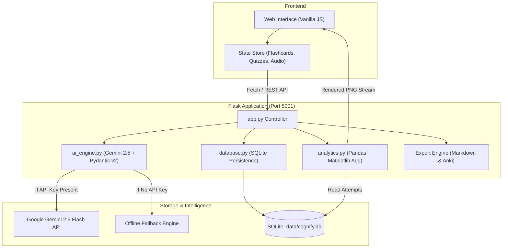

# Cognify

A focused study tool that transforms raw lecture notes and textbook excerpts into structured concept breakdowns, 3D active-recall flashcards, and retention analytics.

---

## Why Cognify?

Passive studying is deceptive. Highlighting notes and rereading textbook paragraphs creates the illusion of competence: the material looks familiar on the page, but when you are tested on an applied problem, recall collapses.

Cognitive science has repeatedly shown that durable learning requires three things:
1. **Active retrieval**: forcing your brain to pull information out, rather than passively recognizing it.
2. **Spaced repetition**: reviewing concepts right when forgetting begins to set in.
3. **Targeted diagnostics**: knowing exactly which subtopics you struggle with before exam day.

I built Cognify to automate this entire workflow. You paste in messy notes, lecture transcripts, or textbook chapters, and Cognify deconstructs them into typed mental models, creates Leitner spaced-repetition flashcards, generates multiple-choice recall quizzes with detailed explanations, and visualizes your retention curve over time.

---

## What It Does

- **Structured Concept Extraction**: Identifies primary theorems, definitions, formula derivations, and common exam traps without conversational filler.
- **3D Leitner Flashcards**: Interactive cards with smooth 3D flip physics, keyboard bindings (Spacebar to flip, 1-4 to rate), and four spaced intervals (Again, Hard, Good, Easy).
- **Active-Recall Quizzes**: Timed 5-question tests with instant grading, option rationales, and error-tagging that logs your weak spots directly to a local SQLite database.
- **Speech Audio Tutor**: Reads executive summaries, definitions, and questions aloud using the Web Speech API for auditory review.
- **Visual Performance Telemetry**: Uses headless Pandas and Matplotlib to plot your rolling retention curves and subject mastery averages over time.
- **Universal Exports**: Download study packs as tab-separated Anki decks (`.txt`), clean Markdown (`.md`) for Obsidian and Notion, or print-ready PDF cheat sheets.
- **Zero-Config Offline Fallback**: If you don't have a Google Gemini API key configured, Cognify automatically falls back to an offline dataset of realistic STEM and humanities topics, so the app is immediately usable upon cloning.

---

## System Architecture



---

## Technical Highlights

- **Typed Schema Validation**: Built on Google's `google-genai` SDK and Pydantic v2. The language model is constrained to output structured JSON matching a strict `StudyPackSchema`, preventing schema mismatch and hallucinations.
- **Headless Plotting on macOS & Linux**: `analytics.py` binds `matplotlib.use("Agg")` before importing Pyplot, avoiding GUI window server crashes and serving streaming PNG charts directly from memory buffers.
- **Decoupled Architecture**: The frontend is vanilla JavaScript with a centralized reactive state store, keeping the UI independent of backend templates and easy to restyle or port.

---

## Getting Started

### 1. Clone the repository
```bash
git clone https://github.com/lalitg13/cognify.git
cd cognify
```

### 2. Set up a virtual environment
```bash
python3 -m venv venv
source venv/bin/activate
pip install -r requirements.txt
```

### 3. (Optional) Configure Gemini API Key
Cognify runs in demo mode out of the box. If you want live AI generations with your own Google Gemini key:
```bash
cp .env.example .env
```
Open `.env` and paste your key:
```env
GEMINI_API_KEY=your_actual_gemini_api_key_here
```
You can also supply or change your API key at any time directly through the in-app modal.

### 4. Run the server
```bash
python app.py
```
Open your browser and visit: **http://localhost:5001**

---

## Project Structure

```text
cognify/
├── .env.example             # Environment variable template
├── .gitignore               # Ignores venv, local databases, and caches
├── requirements.txt         # Core dependencies
├── app.py                   # Flask REST server and route handlers
├── ai_engine.py             # Gemini 2.5 Flash wrapper + Pydantic schema + offline fallback
├── database.py              # SQLite storage layer with seed data
├── analytics.py             # Headless Pandas and Matplotlib chart generator
├── templates/
│   └── index.html           # Semantic HTML5 layout
├── static/
│   ├── css/
│   │   └── style.css        # Dark-mode styling, 3D card physics, and animations
│   └── js/
│       └── app.js           # Vanilla JS state store, Leitner reviews, and quiz runner
└── README.md                # Documentation and architecture guide
```

---

## API Reference

| Endpoint | Method | Description |
| :--- | :--- | :--- |
| `/api/dashboard` | GET | Returns summary KPIs, AI mode status, and recent study sessions. |
| `/api/generate` | POST | Accepts raw notes and optional subject hint; returns a validated study pack. |
| `/api/session/<id>` | GET | Retrieves full JSON payload of a previously saved study session. |
| `/api/session/<id>` | DELETE | Deletes a study session and its corresponding quiz records. |
| `/api/submit_quiz` | POST | Logs quiz completion, score percentage, duration, and weak subtopics. |
| `/api/flashcard/review` | POST | Logs spaced repetition ratings (`again`, `hard`, `good`, `easy`). |
| `/api/analytics.png` | GET | Returns a live Matplotlib chart (`view=mastery` or `view=diagnostics`). |
| `/api/export/<id>/markdown` | GET | Generates and downloads a clean Markdown study guide. |
| `/api/export/<id>/anki` | GET | Generates a tab-delimited Anki deck file ready for import. |
| `/api/reset_demo` | POST | Re-initializes the local SQLite database with default sample data. |

---

## Verification & Testing

You can verify the backend services from your terminal:

```bash
# Test SQLite initialization and seeding
python database.py

# Test headless Matplotlib figure generation
python analytics.py

# Test AI engine schema and offline fallback
python ai_engine.py

# Run API integration checks
python -c "
from app import app
client = app.test_client()
assert client.get('/api/dashboard').status_code == 200
assert client.get('/api/analytics.png?view=mastery').status_code == 200
print('All core API routes verified.')
"
```

---

## License

MIT License. Feel free to use, modify, and build upon this project.
